# 25-26秋 暑假总结

有没有必要“总结”呢，不管了，还是写出来吧，给以后的自己留一些回忆。（其实本该在一个月之前就写出来，奈何我一直在拖延💦）

这个暑假的主线大概就是“短学期”课程了。我同时选了 CTF101 (一种信息安全相关的夺旗赛) 和 HPC101 (高性能计算,101的意思是零基础课程)，并且后者几乎占据了我的假期。这两门课程为我进一步打开了对计算机世界的认识，也激发了一些我对学习过程和方法、使用人工智能的思考。虽然没学到太多东西，但感谢公司赞助和学校/学长们的资源，我体验到了很不错的大模型，接触到了一点点前沿知识。

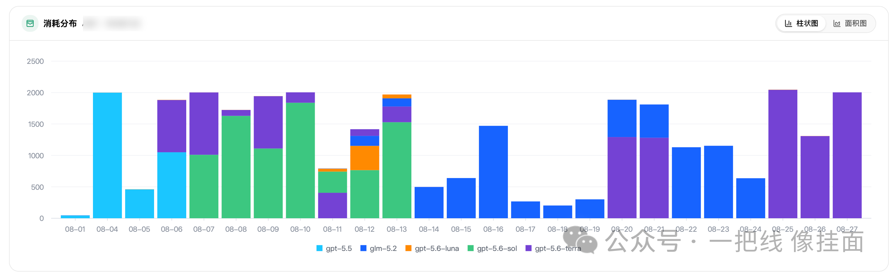

下面图是短学期平台中截出来的，用量太多所以打码了，可以理解为AI一直连轴转……

CTF 在某些方面有点像脑筋急转弯之类的游戏，绕过一些限制，切换一些视角，从而解开一些谜题。这门课的难度和给分都是友好的，尽管做作业的时候也有些痛苦，但 ai 可以相对轻松的跑出来。而今年的 HPC 的难度就比较很大（至少对我的ai来说是这样），而绝大多数时间我都在“许愿式”编程和长时间等待ai的自我迭代和手动唤醒掉崩掉的 ai。所以通过时间的分配来看，我的学习方法无疑是有问题的，尽管我在尝试摄取尽可能多的知识。

???+info "以下是对于 HPC101 和 AI 的思考。"

    如果能重来的话，我应该亲手做性能分析，亲手参与代码的编写和思路优化。奈何任务实在是太难，且我基础不足，且总是把任务拖到剩下几天才开始。在结课之后的课程交流群中，学长们表示设置高难度是防止 AI 端到端直接“秒杀”，但这导致了大多数的作业含人量进一步降低。如果我有优化方向和明确的思路、提示词，ai 应该可以作为我的好帮手，一个实验应该较快的跑完。奈何没有方法，我甚至需要求着 ai 来帮我讲解。（这门课也没提供参考 writeup 和参考提示词，直到现在我也不知道被幻觉或者错误坑了多少。。过度依赖 AI 让我产生了虚无感和无用感。。）我把更多的时间用来许愿式编程和刷分，一个实验需要大模型跑上几天才能获得一个相对好看的分数。于是我没有精力关注代码和思路本身（太懒，刷完分就有一种任务完成了的错觉）。理论知识必须要在实践中才能深刻掌握。纸上得来终觉浅。

    随着时代的发展，更多的方向和工作越来越无法摆脱 Agent，Agent 是个好东西，^^**它们的发展实在太快，快过了人调整姿势的速度，快过了人的学习，快过了人的耐心**^^。在这个短学期中，我初步了解了大模型内部的机制。海量的数据在宏观上体现出智慧，矩阵运算的结果帮助我们答疑解惑，它们生成的命令有效地解决问题。但是，我忽略了他们的幻觉，他们千篇一律的输出，他们缺乏灵感……一些 ai 计算出的“文章”和“视频”，和某些讨论 ai 的言论和视频中有着一股隐隐约约的浮躁之风，一些“古法”的知识也面临着被指责无用的困境。^^**人类大脑产生的思想应该比一些梯度下降和矩阵乘法来的运算产物更宝贵**^^，不是吗？

    值得庆幸的是，目前 ai 产生的废料应该只占少数，且课程注重人的学习。比如，互联网还是有很多人类含量高的优秀视频/文章。比如这学期的 ADS 加了 ai 生成检测，SYS2 加了上机考试(这个其实没有也行，哈哈💦💦)。在这学期的软件保护课程上，跟着老师一点一点调试，还是很有成就感的。

上面有点过于正经了。这个假期中间还穿插了多次练车，开了高速，最后甚至有点上瘾，开车去接朋友吃饭，哈哈（由于空间感不强，我还把车给磕了）。末尾我去了云南游玩，感谢我的好兄弟们，如果不是你们带上我，我恐怕真要一直窝着了，哈哈。佩服你们的超强计划能力和在陌生环境认路寻找方向的能力。

| 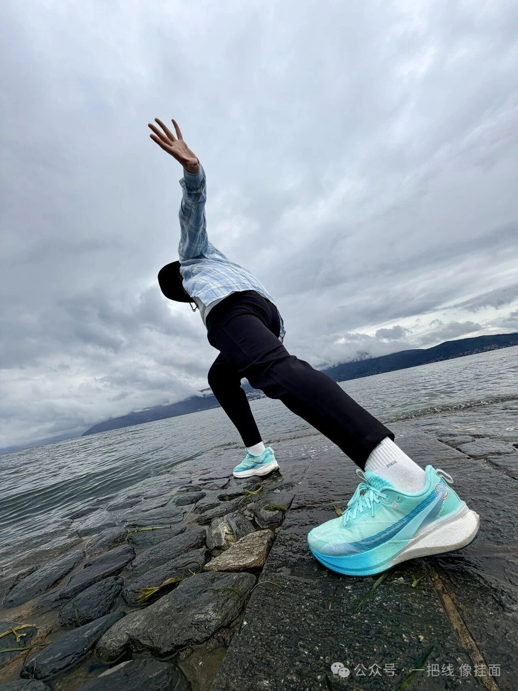 | 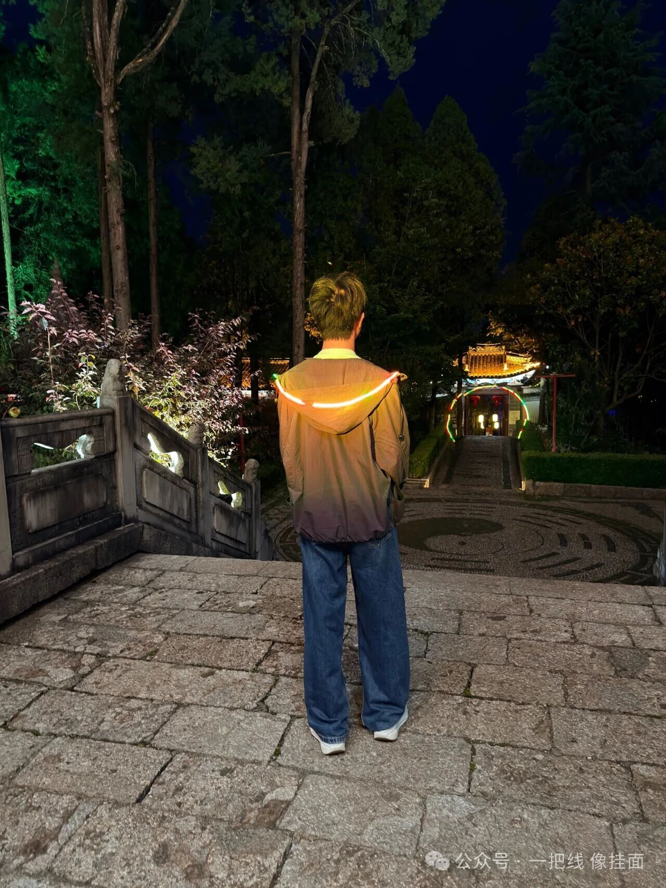 |
| :--: | :--: |
|  | 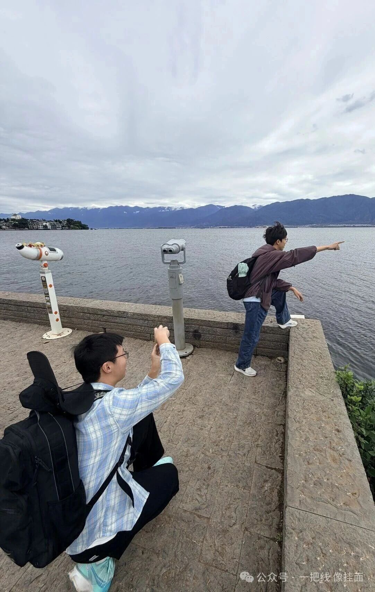 |

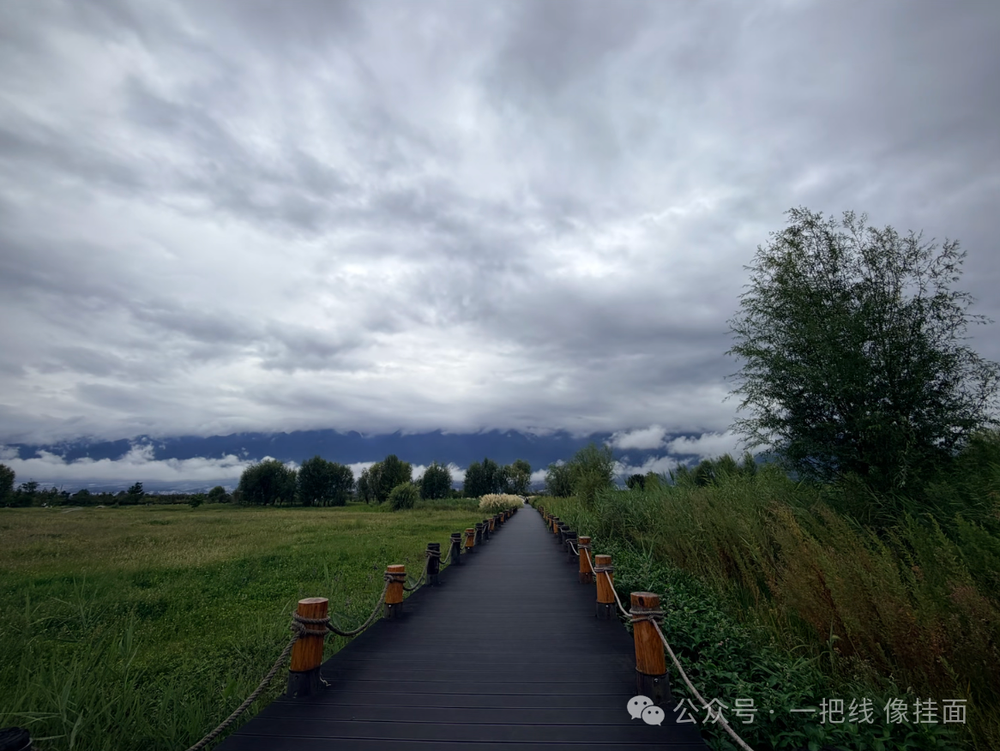

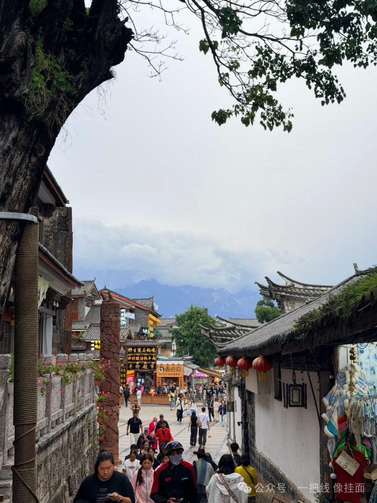

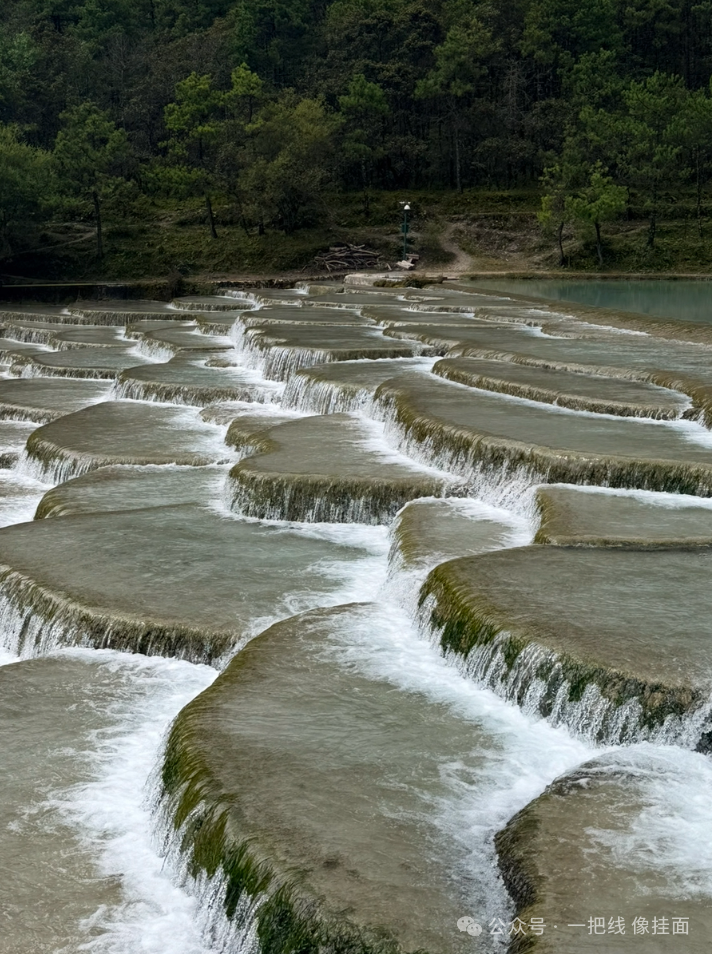

下图是玉龙雪山的索道。登顶之后下来买的烤肠是真好吃吧（

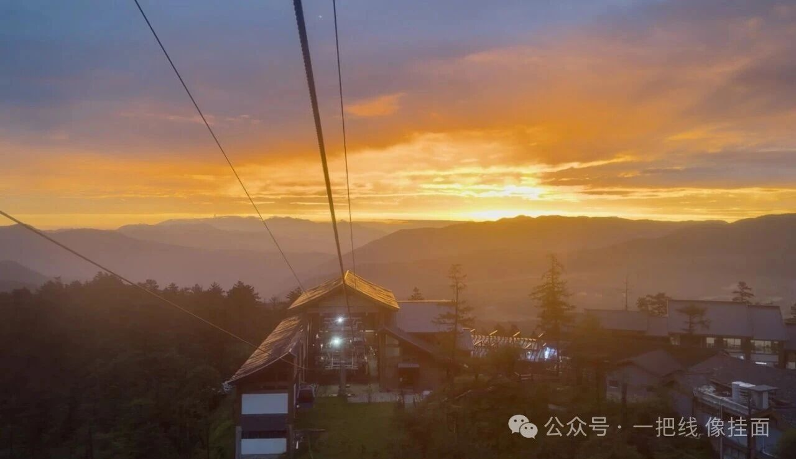

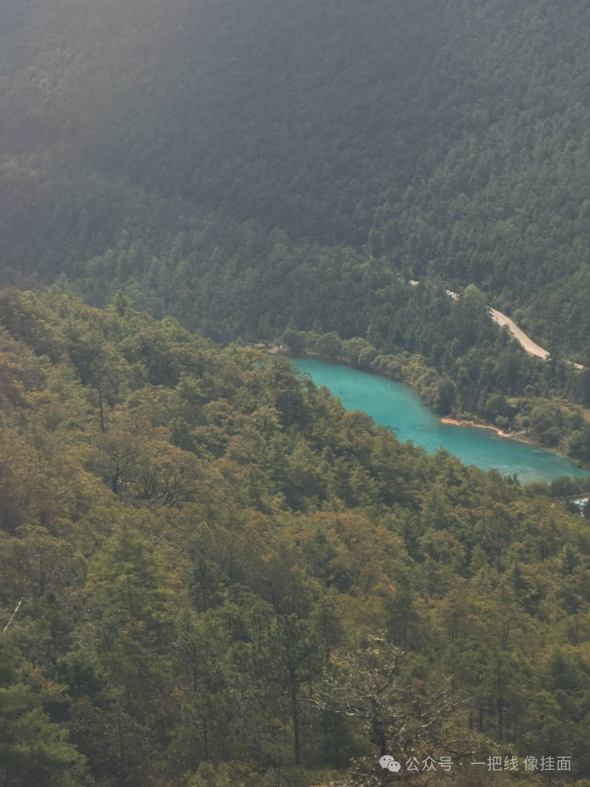

小牛小羊

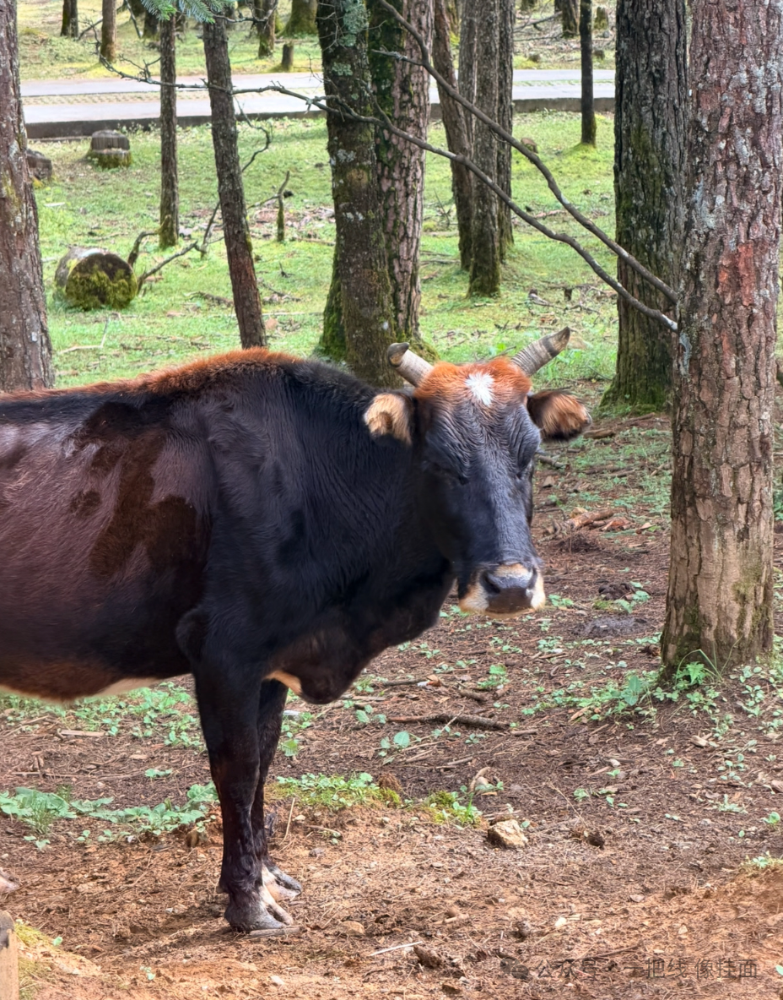

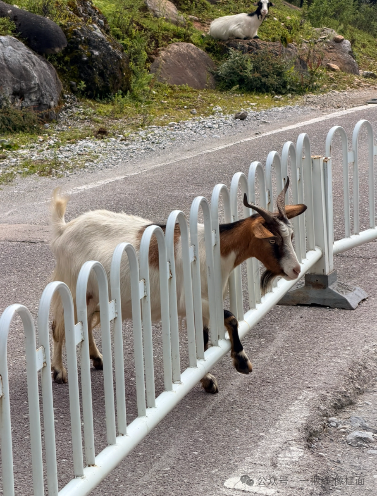

后来，开学前，一个高中的同学来杭州找我玩（9.12）；十一假期期间，另一位同学来杭州（10.3）；假期最后两天天气大好，我去合肥找了同学玩。三段很美好的经历！

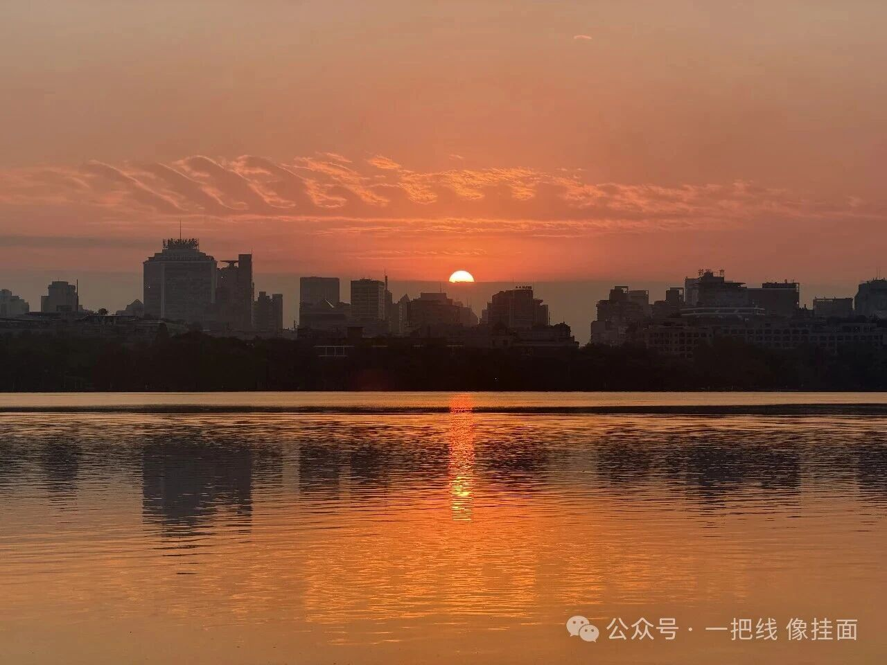

| 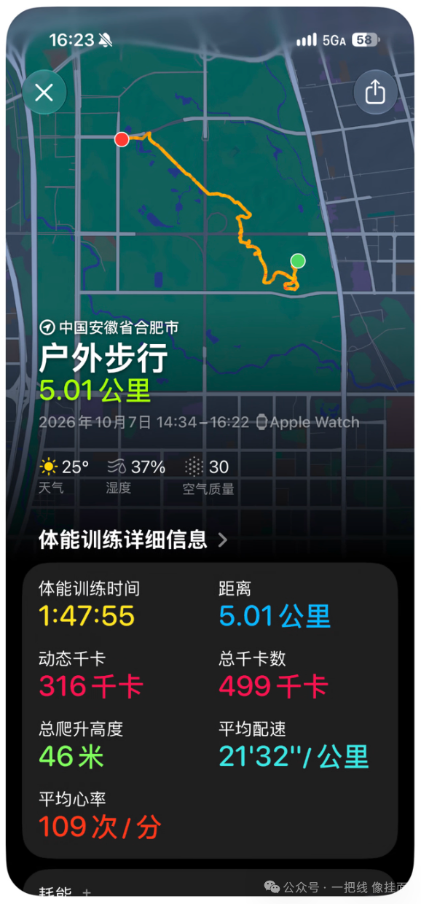 | 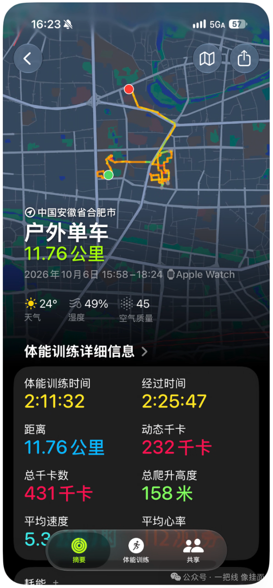 |
| :--: | :--: |

音乐依旧是继续听，琴还是没开始弹，不知道什么时候能捡回来。

Eight Concert Etudes Op.40: Pastoral - Nikolai Kapustin

Eight Concert Etudes Op.40 : Prelude - Nikolai Kapustin

Instant Crush - Daft Punk / Julian Casablancas

Survival (2003 Remaster) - Yes

