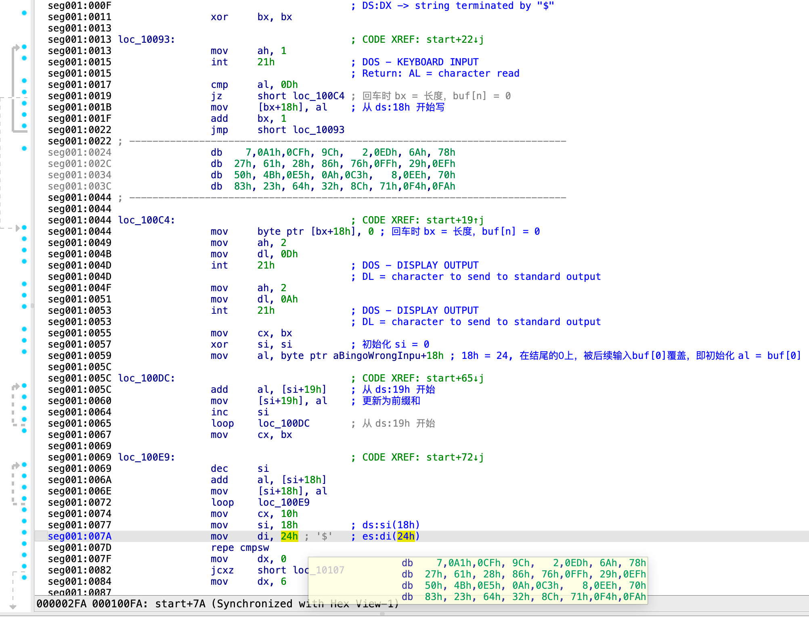

# Hidden Executable

默认会选择 `Portable executable for 80386 (PE)[pe.dylib]`



这是一个 MS-DOS 文件，需要正确地选择类别。其中 seg001:0024 被默认解析成了代码，切换为数据即可。

`#!nasm repe cmpsw`, compare string word, repeat if equal. `DS:[SI], ES:[DI]`.

段寄存器定义为：

```nasm
dseg:0000 dseg            segment para stack 'DATA' use16
dseg:0000                 assume cs:dseg
dseg:0000 aBingoWrongInpu db 'bingo$wrong$input flag:$',0
dseg:0019                 align 80h ; 校验字符串存放
dseg:0019 dseg            ends

seg001:0000 start           proc near
seg001:0000                 mov     ax, seg dseg
seg001:0003                 mov     ds, ax
seg001:0005                 assume ds:dseg
seg001:0005                 mov     ax, seg seg001
seg001:0008                 mov     es, ax
seg001:000A                 assume es:seg001
```

输入先做一次前缀和(100DC)，再从后往前累加一遍(100E9)，最后和 seg001:0024 比对。

```pyodide
table = bytes([
    0x07, 0xA1, 0xCF, 0x9C, 0x02, 0xED, 0x6A, 0x78,
    0x27, 0x61, 0x28, 0x86, 0x76, 0xFF, 0x29, 0xEF,
    0x50, 0x4B, 0xE5, 0x0A, 0xC3, 0x08, 0xEE, 0x70,
    0x83, 0x23, 0x64, 0x32, 0x8C, 0x71, 0xF4, 0xFA,
])
n = 31
# & 0xFF 防止溢出，可以删掉试一下，会报错。
b = [(table[i] - table[i + 1]) & 0xFF for i in range(n - 1)] + [table[n]]
flag = [b[0]] + [(b[i] - b[i - 1]) & 0xFF for i in range(1, n)]
print(bytes(flag).decode())
```

暂时先不用 soft-ice 验证了（

所以，如何做到的混淆（正如题干里的"hidden"）呢？看起来像是将 dos 的产物塞到了一个 32 位的程序里？纯 dos 实现类似功能的可执行文件不会这么大……