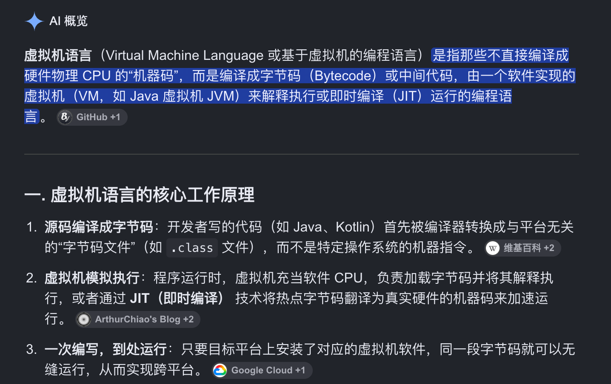

# Reverse 入门

自学记录和 writeup

- [校巴](https://zjusec.com/category/REVERSE)

**- welcome -**

- [Reverse1](reverse1.md)
- [apk01 baby](apk01.md)

**- emoclew -**

- [apk02 守望起来](apk02.md)
- [Reverse2](reverse2.md)
- [Reverse3](reverse3.md)
- [Hidden Executable](hidden.md)
- [find me out](find.md)
- [wasm rpg 1](wasm.md)

**- ACTF2016 -**

- [easy reversing](easy.md)
- [眼见为虚](yanjianweixu.md)
- [Stack Mess](stack.md)
- [邪门的逆向](xiemen.md)

**- 201706 -**

- [you need python3](python.md)

---

??? quote "TODO"
    - [ ] 1. 保护模式（即将在课上学习到）
    - [x] 2. IDA 的使用
    - [ ] 2. softice 的使用（正在熟悉）
    - [x] 3. 安卓 APK（IDA 9.5 新增了功能）
    - [x] 4. 动态调试
    - [x] 5. 题目
    - [ ] 6. 全部工具总结
    - [ ] 7. 标注LLM 使用情况