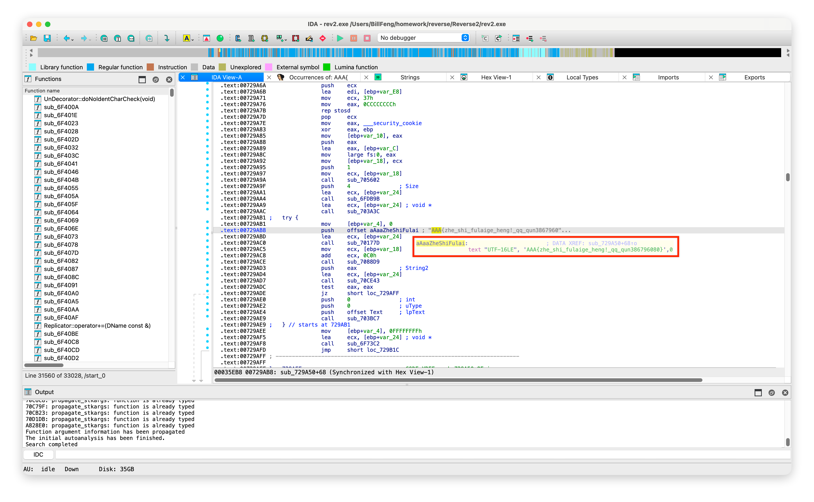
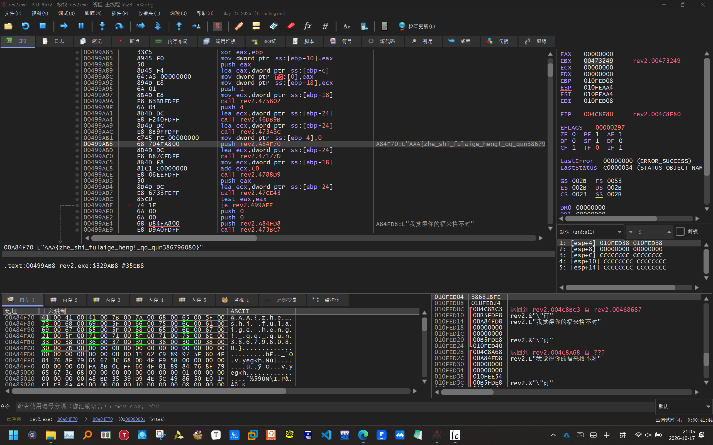

# Reverse2

<!-- AAA{zhe_shi_fulaige_heng!_qq_qun386796080} -->

这道题直接搜索 `AAA{` 就找到了……

当然，需要思考一下如果搜索不到该怎么办，采用动态调试。

x32dbg 75EBCE70 MessageBoxW "我觉得你的福来格不对" 返回到 4C909B

尝试了半天，最终通过查看堆栈上文来解决。

1) 返回到最后一个含有 "我觉得你的福来格不对" 的 MessageBoxW 调用处，查看上文即可找到 "诺，你要的福来格" 和 flag。

2) 继续向下查看堆栈，也可以找到，10FEE28。

为什么这个功能这么简单的程序有 10MB，且有数不清的跳转？